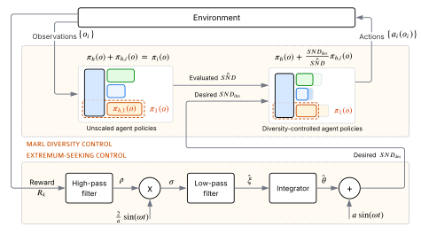

<div align="center">

# ADiCo: Adaptive Diversity Control

### Optimizing Team Behavior via Extremum-seeking Control in Multi-agent Reinforcement Learning

**Svar Rajankumar Patel** · **Kshitij Jerath**<br>
EXA Lab, University of Massachusetts Lowell<br>
*IEEE Conference on Decision and Control (CDC) 2026*

[](https://arxiv.org/abs/2610.18808)
[](https://svar7769.github.io/adico/)
[](https://github.com/Svar7769/AD2C-Diversity)

<br>



<sub>DiCo regulates diversity toward a target during MARL training (fast timescale). ESC uses team reward to update that target between training cycles (slow timescale).</sub>

</div>

---

## Overview

How much behavioral diversity does a cooperative multi-agent team need? Too little prevents agents from specializing; too much can break coordination, and the right amount changes from task to task. Finding it usually means a grid search over fixed diversity targets, one training run per candidate.

**ADiCo** selects the diversity level within a single training run. Diversity Control (DiCo) regulates the team's System Neural Diversity (SND) toward a target, and Extremum Seeking Control (ESC) perturbs that target, measures the effect on team reward, and moves it toward better performance.

## Citation

```bibtex
@inproceedings{patel2026adico,
  title     = {Optimizing Team Behavior via Extremum-seeking Control in Multi-agent Reinforcement Learning},
  author    = {Patel, Svar Rajankumar and Jerath, Kshitij},
  booktitle = {Proceedings of the IEEE Conference on Decision and Control (CDC)},
  year      = {2026},
  note      = {arXiv:2610.18808}
}
```

<details>
<summary><b>Updating this site</b></summary>

<br>

The main page is generated. Edit `templates/index.html` (header, links, sidebar) or `sections/adico/*.html` (content), never `index.html` directly, then run:

```bash
python3 build.py
```

`dico.html` and `esc.html` are edited directly. Pushing to `main` rebuilds and deploys through GitHub Actions.

</details>
